<p align="center">
  <picture>
    <source media="(prefers-color-scheme: dark)" srcset="Design/icon-dark.png">
    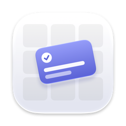
  </picture>
</p>

<h1 align="center">Issues</h1>

<p align="center">
  <b>A fast, native app for GitHub Issues on Mac, iPhone and iPad</b>, with the board, keyboard flow and polish of Linear.<br>
  Everything stays in GitHub, so teammates who don't use the app notice nothing.
</p>

<p align="center">
  <a href="https://apps.apple.com/app/id6819589759">
    <picture>
      <source media="(prefers-color-scheme: dark)" srcset="Website/images/app-store/en-dark.svg">
      
    </picture>
  </a>
</p>

<p align="center">
  
  
  
  
  <a href="LICENSE"></a>
  <a href="CHANGELOG.md"></a>
</p>

<p align="center">
  <a href="#a-quick-tour"><b>Tour</b></a> &nbsp;·&nbsp;
  <a href="#iphone-and-ipad"><b>iPhone and iPad</b></a> &nbsp;·&nbsp;
  <a href="#getting-started"><b>Getting started</b></a> &nbsp;·&nbsp;
  <a href="#using-it"><b>Shortcuts</b></a> &nbsp;·&nbsp;
  <a href="CHANGELOG.md"><b>Changelog</b></a> &nbsp;·&nbsp;
  <a href="https://lukaskaibel.github.io/issues-for-github/"><b>Website</b></a>
</p>

<br>

<picture>
  <source media="(prefers-color-scheme: dark)" srcset="Design/screenshots/hero-dark.webp">
  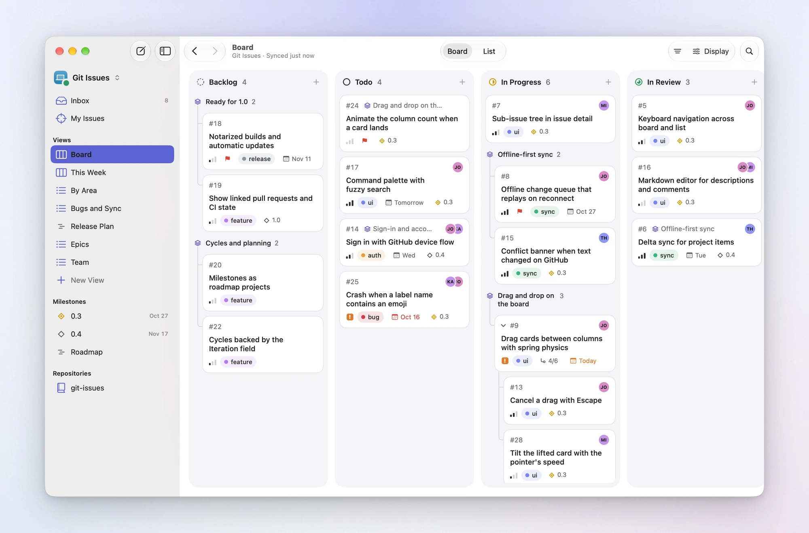
</picture>

> **New: Issues for iPhone and iPad.** The same app, built from the same project, with the same sync, offline
> queue and actions: lists with swipes and the issue menu on iPhone, the board with drag and drop on iPad.
> [See it below.](#iphone-and-ipad)

> **Status: early.** Version 0.3.0 covers the daily work with issues on the Mac, iPhone and iPad: boards and lists,
> the Inbox, due dates, sub-issues and blockers, in nine languages. The Mac app is
> [in the App Store](https://apps.apple.com/app/id6819589759), and the iPhone and iPad app is on its way there. You can
> also build it from source (five minutes, see below).

## Why

GitHub Issues holds the data most teams already have. Its interface is slow to drive: every status change is a
page load and a menu. This app puts a native, keyboard-first front end on the same data. It reads and writes
GitHub Projects, issues, sub-issues, labels, assignees and comments, and stores nothing anywhere else.

## A quick tour

### A board you can pick up

Drag a card and it lifts off the board, tilts with the motion and settles with a spring, while its neighbours make
room. Press Esc mid-drag and it goes back to where it came from. The move shows in the same frame and reaches
GitHub in the background.

<picture>
  <source media="(prefers-color-scheme: dark)" srcset="Design/screenshots/drag-dark.webp">
  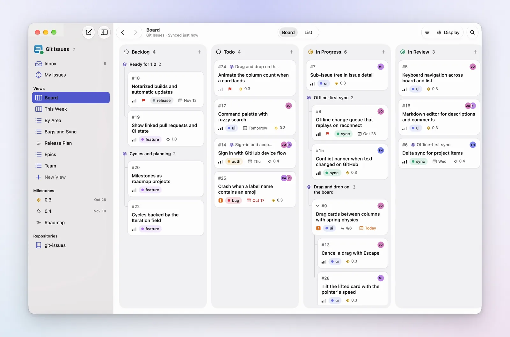
</picture>

A sub-issue with the same status as its parent hangs right under it, indented, so a parent and the sub-issues you
work on with it read as one instead of as separate cards in the same column. The arrow on the parent folds them in. A
sub-issue whose parent has another status stays in its own column and says which issue it belongs to. When the last
one is done, the parent moves to Done by itself. The issues of an epic in the same column stand together the same
way, under the epic's name; drag the name to another column and they all go.

Every property is one click away: click a card's priority, status, labels, assignees, due date or sub-issue count
and a dropdown opens right there. Type to filter, press a number to pick; the pick closes it. For several assignees or
labels, tick their checkboxes or Shift-click them, and it stays open. Right-click a card for everything at once.

### Due dates that remind you

Press `D` and give an issue the day it is due: today, tomorrow, Friday, next week, a day in the month, or typed in a
few words ("fri", "in 3 days", "12.10."). Cards and rows show the date, orange on the day and red once it has passed.
On the day an issue assigned to you is due, your Mac, iPhone and iPad each remind you with a notification, whose
buttons start the issue, mark it done or move it to tomorrow. The date is the project's "Due date" field on GitHub,
so your team sees it there; GitHub's dates have no time of day, and the reminder comes at the time set in Settings.

<picture>
  <source media="(prefers-color-scheme: dark)" srcset="Design/screenshots/due-date-dark.webp">
  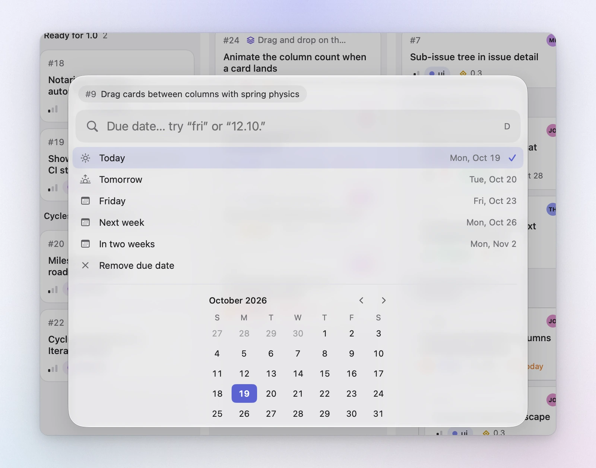
</picture>

### Issues that read well

Descriptions are Markdown, edited in place: click and type. One with a table, a checklist, code or a Mermaid diagram
is drawn the way GitHub draws it, with checkboxes that tick; a click on the text brings up the Markdown. Sub-issues come
with a progress bar, and the plus beside them adds a new one or an issue that exists already. What blocks the issue and
what it blocks are listed below; a blocked issue carries a red flag on its card. Comments sit below, and status,
priority, assignees, labels, parent and blockers are in the sidebar. Step to the next issue with the arrows at the top.

<picture>
  <source media="(prefers-color-scheme: dark)" srcset="Design/screenshots/issue-dark.webp">
  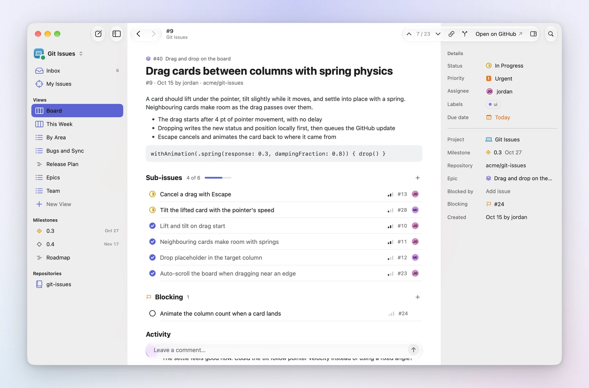
</picture>

### An inbox for what changed

The Inbox shows what happened that concerns you, as Linear's does: who assigned you, mentioned you, commented, asked
for your review or closed an issue you follow. It is GitHub's own notifications, so what you read or archive here is
read or done on github.com and on your other devices too. Pick one and its issue opens beside the list, with what's
new on top and the new comment marked; change it right there, and press S to put one that's on none of your boards
onto one. J and K move on, U marks read or unread, E archives and H snoozes until later. Issues of yours that are due
join the list on the day, and the morning after if they're still open, with the reminder's buttons: Start, Mark as
Done and Move to Tomorrow. So do issues your own account assigned you to outside the app, with `gh`, a script or a
coding agent signed in as you: GitHub never notifies you of those, so the app finds them itself, and leaves out the
ones you assigned yourself to in the app.

<picture>
  <source media="(prefers-color-scheme: dark)" srcset="Design/screenshots/inbox-dark.webp">
  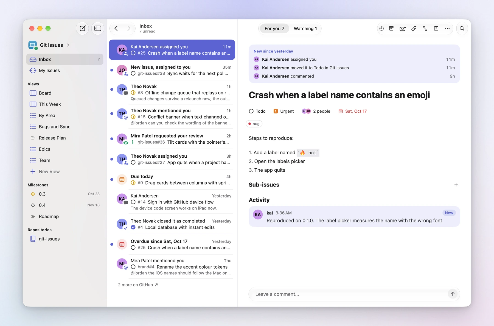
</picture>

### Keyboard first

⌘K opens the command palette: every action, and a search across your issues. Single keys act on the issue you
hover or reach with the arrow keys: `S` status, `P` priority, `A` assignee, `L` labels, `D` due date, `I` assign to me.

<picture>
  <source media="(prefers-color-scheme: dark)" srcset="Design/screenshots/palette-dark.webp">
  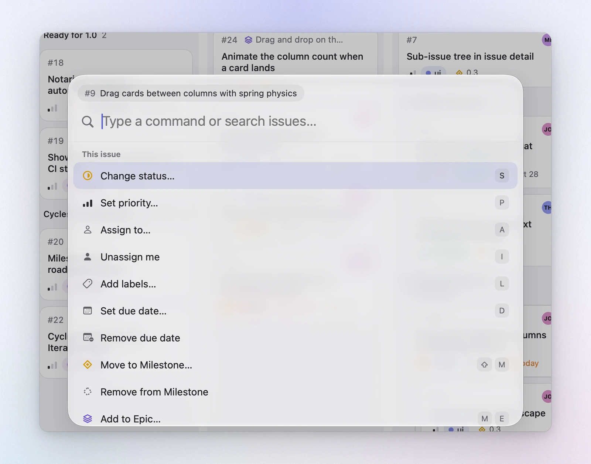
</picture>

`C` starts a new issue wherever you are. Type the title, set its properties, and ⌘↵ creates it.

<picture>
  <source media="(prefers-color-scheme: dark)" srcset="Design/screenshots/new-issue-dark.webp">
  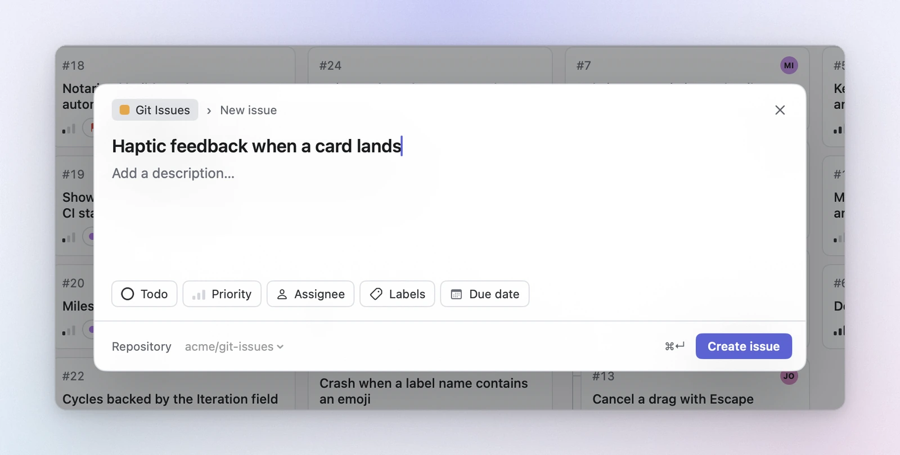
</picture>

### A list, in light or dark

The list groups issues by status. Each header stays pinned while you scroll through its section and folds it with
a click. Drag an issue up or down to give it a new place, or into another section to change its status, as on the
board. The app follows the system appearance, or stays light or dark if you prefer.

Its icon is a planning board: an index card, a screenshot of code and a sticky note, pinned up and joined with string.
Settings (on iPhone and iPad, your account) offers the board in seven materials: the warm grey fabric pinboard, cork,
metal with magnets, a whiteboard, and slate, navy or sage fabric. Each follows light and dark mode.

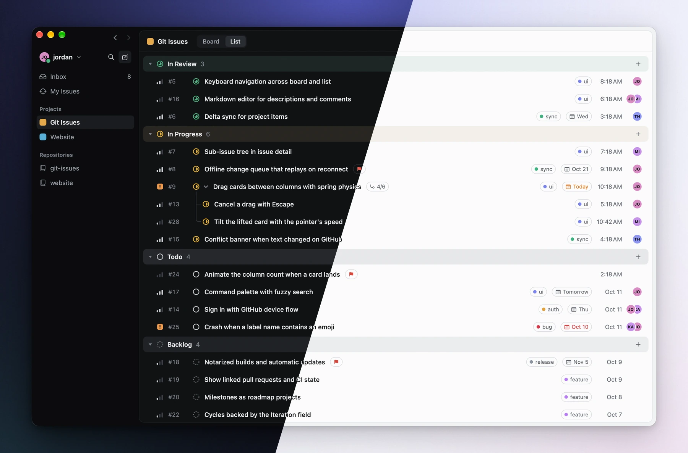

### Every issue, on a board or not

An issue someone opened straight in a repository isn't lost because nobody put it on a board. The sidebar lists the
repositories of the project you're in, like the teams in Linear, and each shows all its issues, grouped by status like
My Issues. Those on no board come first, under **No project**: click the circle with the plus (or press `S`), pick a
column, and the issue is on the board. My Issues shows everything assigned to you, on a board or not.

<picture>
  <source media="(prefers-color-scheme: dark)" srcset="Design/screenshots/repository-dark.webp">
  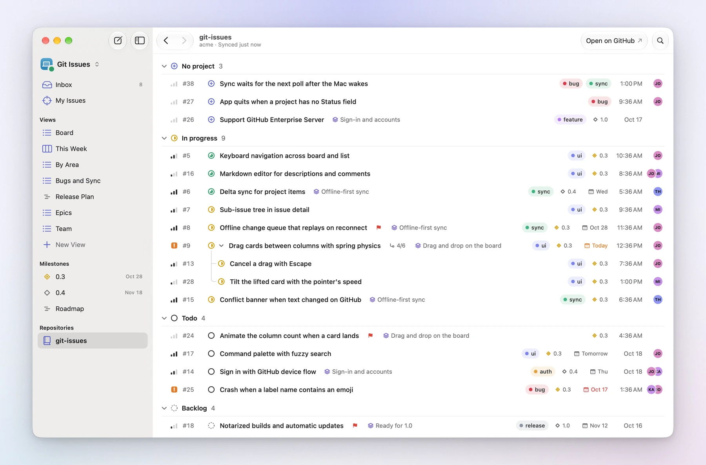
</picture>

### Milestones, epics and a roadmap

Plan a board the way Linear plans releases and projects, with what GitHub has. Its next milestones sit under
Milestones in the sidebar; each shows the board's columns with only its issues, or a list grouped by epic, with how much is done
and the day it is due. `⇧M` puts issues into one. An epic is an issue labelled "epic" whose sub-issues are the work:
**Make Epic** in the right-click menu, `M` then `E` to put an issue into one. On the board and in the list, the
issues of an epic in the same column stand together under its name, so you see at a glance what belongs to what;
drag the name and they move together, drop a card among them and it joins the epic. The roadmap lays the epics out over
the milestones their unfinished issues are in, on a timeline: drag a bar onto another milestone and the epic moves
there with everything left to do, drag a milestone's diamond to change its day. When a milestone's day has come,
**Complete** closes it on GitHub and moves what isn't done to the next one.

<!-- The roadmap's picture comes with the next shared picture run (Tools/readme-images.sh):
<picture>
  <source media="(prefers-color-scheme: dark)" srcset="Design/screenshots/roadmap-dark.webp">
  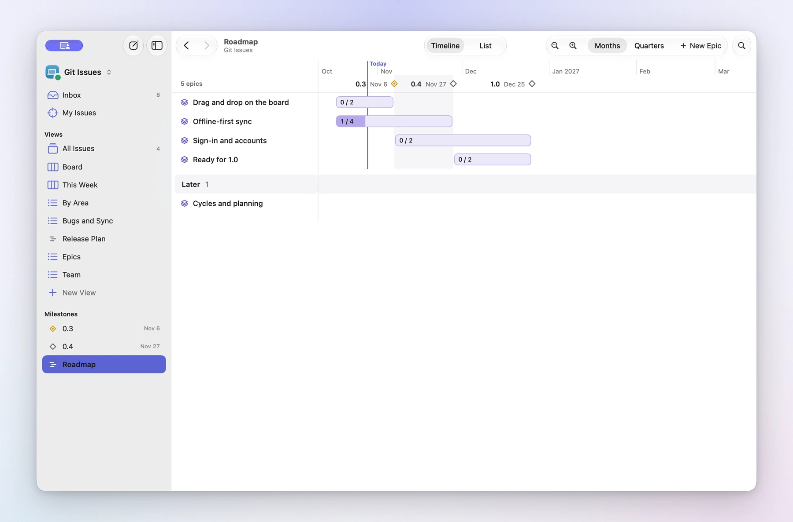
</picture>
-->

### A project's views, in the sidebar

The sidebar is about one project at a time, as Linear's is about one workspace: the project sits at its top with an
icon you pick, its menu switches to another, and under it are the project's views as GitHub has them, such as "This week" or open bugs by area, then its milestones and its repositories. A view
shows what its filter finds, as a board or as a list grouped the way GitHub groups it. The filter is a row of chips
over the issues, as in Linear: press `F` to add one for a status, a person, a label, a milestone, an iteration or any field
of the project, click a chip to change it. A changed filter stays yours until you press `⌘S`, which saves it to the
view for everyone; `⇧V` shows a view as board or list, by other columns or groups, or with the iteration on its cards.
New views, renamed ones and deleted ones are GitHub's too, so a view looks the same on github.com.

<!-- The views' picture comes with the next shared picture run (Tools/readme-images.sh):
<picture>
  <source media="(prefers-color-scheme: dark)" srcset="Design/screenshots/views-dark.webp">
  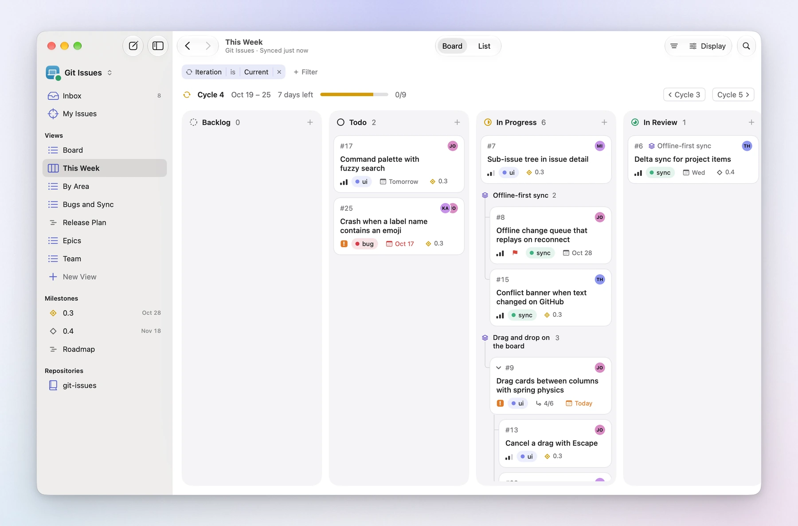
</picture>
-->

What a view is for decides how it looks, read from how it is set up on GitHub. Grouped by parent issue, milestone or
iteration, its groups show how far each is, and those with nothing under way start folded: a view of work packages
opens as an overview. Grouped by assignee, each person's bar is what they have open. A view of one iteration shows
that cycle on top, with the days left and arrows to the one before and after. A roadmap view is a timeline of the
issues' start and target dates, their iterations or their milestones.

<!-- The timeline's picture comes with the next shared picture run (Tools/readme-images.sh):
<picture>
  <source media="(prefers-color-scheme: dark)" srcset="Design/screenshots/timeline-dark.webp">
  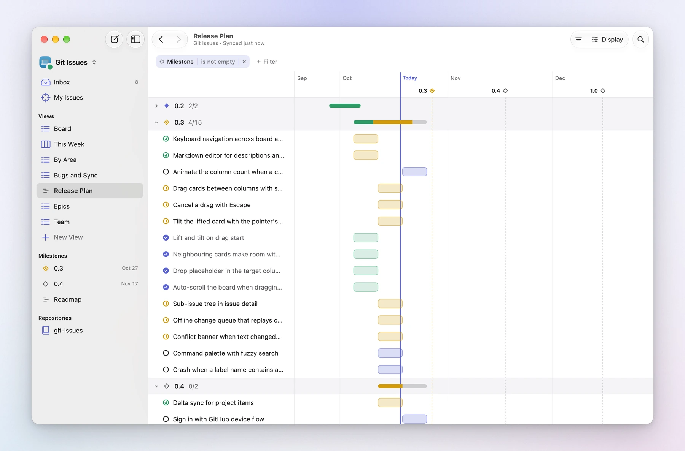
</picture>
-->

## iPhone and iPad

<picture>
  <source media="(prefers-color-scheme: dark)" srcset="Design/screenshots/devices-dark.webp">
  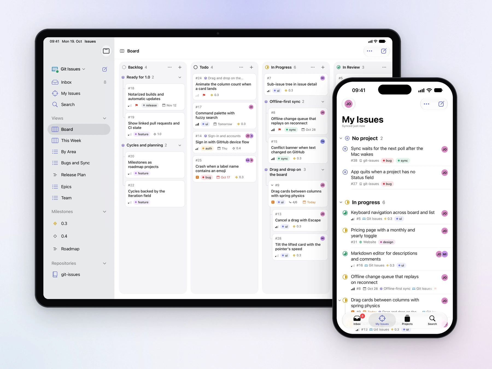
</picture>

The iPhone and iPad app is the same app as the Mac's, built from the same project: sync, offline queue, conflict
handling and every action are shared code, and so are the colours, status circles, priority bars, labels and avatars.
The interface uses the system's own parts.

<picture>
  <source media="(prefers-color-scheme: dark)" srcset="Design/screenshots/iphone-dark.webp">
  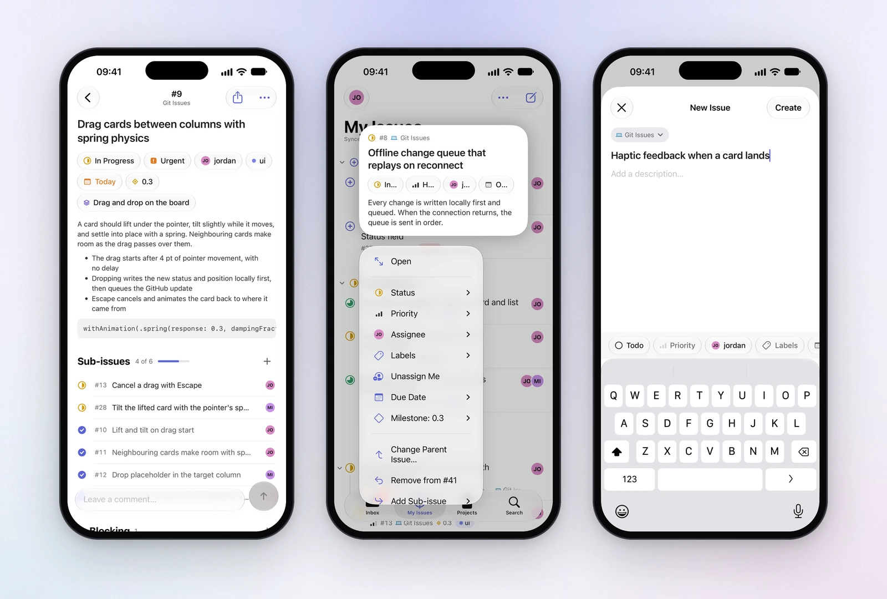
</picture>

- **iPhone:** a list per project, per repository and My Issues, grouped by status, with sections that fold and
  headers that stay pinned. Tabs for the Inbox (with its count), My Issues, Projects (with the repositories below the
  projects) and Search. Swipe right to mark an issue done, swipe left to assign it to yourself or delete it, touch and
  hold for the same menu as the Mac's right-click, and drag after holding to give an issue a new place in its section.
  Sub-issues with their parent's status hang under it, as on the Mac, and the arrow beside the parent folds them.
  A board's next milestones and its roadmap are listed under it in Projects; a milestone is a list grouped by epic,
  the roadmap a list of epics by milestone. A project's views are capsules over its list, with the open one's filter
  as a line under them; tap the line to change the filter, touch and hold a view for its menu. A view's groups show
  their progress or each person's load, and a view of one iteration has the cycle on top, as on the Mac.
  In the Inbox, swipe right to read and left to snooze or archive. In an issue, the title and description are edited in
  place (Markdown is styled as you type; tables, checklists, code and Mermaid diagrams are drawn until you tap them),
  the properties are chips under the title, and the comment field stays at the bottom as in Messages.
- **iPad:** the tabs become a sidebar, as on the Mac: the project at the top with its icon, whose menu switches
  projects, changes the icon and opens your account, then its views, its next milestones and roadmap, and its repositories, each an entry. A view opens as a board, a list or, for a roadmap view, a timeline; cards are moved with drag and
  drop (touch and hold, then drag). A milestone opens as the board's columns or a list, the roadmap as the timeline,
  whose bars move with a finger. An issue shows its properties in a column
  beside it, and the Inbox shows the selected issue beside its list, as in Mail. With a keyboard, the Mac's shortcuts
  work: J and K, S P A L I, ⌘1 ⌘2 ⌘3 ⌘4, ⌘K, ⌘N, ⌘R, ⌘[ and ⌘↵, and in the Inbox U, E, H and ⇧S. S, P, A and L open
  their picker ready to type in; Return picks the first match.
- **Sample data:** "Explore with Sample Data" on the sign-in screen shows two sample projects without a GitHub account.
  Nothing there is sent anywhere.
- **In the background:** changes made just before locking the phone are still sent, and iOS refreshes the app now and
  then so it opens up to date, the Inbox included. Reminders of due issues are notifications the phone schedules
  itself, so they come on time. There are no other push notifications: GitHub can't push to an app without a server
  of its own, which Issues deliberately doesn't have.

## What it does

- **Board and list** for every GitHub Project you can see, plus **My Issues**: everything assigned to you.
- **Every issue of your repositories**, also those on none of your boards, which one click puts on one.
- **Sub-issues and blockers.** Put any issue under another one, add issues that exist already as sub-issues, and mark
  which issues block which, with a red flag on blocked cards. Sub-issues with their parent's status hang under it on
  the board and in the list, and a parent is done when its last sub-issue is.
- **Milestones, epics and a roadmap.** A board's milestones with their own board and progress, epics whose
  sub-issues are the work, and a roadmap of the epics over the milestones, on a timeline or as a list. Completing a
  milestone closes it on GitHub and moves what is left to the next one.
- **A project's views** in the sidebar, one project at a time, with a filter of chips like Linear's that is GitHub's
  own filter underneath. Change it for yourself, save it for everyone, or make, rename and delete views; GitHub shows
  the same. Each view shows what it is for: work packages with their progress, a team with each person's load, a cycle
  with its days left, a roadmap as a timeline.
- **An Inbox** with GitHub's notifications about issues and pull requests: who did what, the issue beside it, and
  read, archive, snooze and unsubscribe in one key. Read and archived are the same on github.com. Issues your own
  account assigned you to with `gh` or a coding agent show up too, which GitHub doesn't notify you of.
- **Instant.** Every change is written to a local database first and shows in the same frame. GitHub is updated in
  the background.
- **Works offline.** Changes queue up and are sent when the connection returns.
- **Careful with other people's work.** Changes are sent field by field, descriptions edited in two places are
  merged, and when a merge isn't possible nothing is overwritten: you choose.
- **Status columns are yours to shape.** Add, rename, recolour and remove columns from the board, and drag a column
  by its header to move it; they are the project's Status field on GitHub. In the list, drag a section by its header
  to arrange the list your way (that order is a preference on your Mac and leaves GitHub alone).
- **GitHub's Markdown.** Headings, lists, code, tables, checklists that tick and Mermaid diagrams, drawn natively
  in the app's type and colours.
- **Keyboard first.** Single keys change status, priority, assignee, labels and the due date. Back and forward work
  like a browser: ⌘[ and ⌘], the side buttons of a mouse, or a two-finger swipe.
- **Due dates and reminders.** The day an issue is due, typed in a few words or picked in a month, and a notification
  on that day for issues assigned to you, from each of your devices.
- **In nine languages.** English, German, French, Spanish, Portuguese (Brazil), Russian, Japanese, Korean and Chinese
  (Simplified), following your device's language. Column and priority names are understood in each of them (an
  "Erledigt" column closes issues as "Done" does), and so are due dates typed in them ("morgen", "来週の金曜").
- **Native.** Swift and SwiftUI, with AppKit where it matters for smoothness. Apple silicon only.
- **On iPhone and iPad too.** One app for all three: the same sync, offline queue and actions, with an interface
  built from the system's own parts (see above).

## How it maps to GitHub

Nothing is invented on top of GitHub. Each concept is the GitHub feature it looks like:

| In the app | On GitHub |
|---|---|
| Board | A GitHub Project |
| Columns | The project's **Status** field |
| Moving a card to a "done" or "cancelled" column | Status changes, and the issue is closed as *completed* or *not planned* |
| Priority | A single-select project field named **Priority** (the app can add it for you) |
| Due date | A date field of the project named **Due date**, *Due*, *Deadline* or *Target date* (the app adds one the first time you set a date) |
| Reminders | Notifications each of your devices schedules itself from the due dates; nothing on GitHub |
| Card order | The item's position in the project |
| Repositories in the sidebar | The repositories linked to the project, and those its issues come from |
| No project | An issue that is in none of your projects; adding it to one is GitHub's *Add to project* |
| Sub-issues, labels, assignees, comments | The native GitHub features |
| Sub-issues hanging under their parent | Only how the app arranges them; GitHub's order and fields stay as they are |
| A parent done with its last sub-issue | The parent's status moves to the done column and it is closed, as if you had moved it there |
| Blocked by and blocking | GitHub's issue dependencies |
| Milestone | GitHub's milestones of the board's repositories; those of the same name are one, and a repository gets a copy when an issue of it goes in |
| Completing a milestone | Closing it on GitHub; its unfinished issues get the next milestone if you choose |
| Epic | An issue with the label *epic* (made in the repository the first time) or, in organisations, the issue type *Epic* |
| An epic's issues | Its sub-issues |
| Roadmap | Only how the app lays out the epics over the milestones; the stretches end on the milestones' due dates |
| A project's views in the sidebar | The project's views, in GitHub's order; board views as a board, table views as a list, roadmap views as a timeline |
| A view's filter chips | The view's filter, in GitHub's own words (`label:bug,sync is:open`, `iteration:@current`) |
| A changed filter, before Save | Kept on your device, as GitHub keeps unsaved changes in your browser |
| Board or list and the fields shown | The view's layout and visible fields, saved with **Save for Everyone** |
| Other columns, groups or order | Yours alone: GitHub sets a view's columns, grouping and sorting only when it is made |
| Iteration on a card or row | The project's Iteration field, or any single-select field the view shows |
| A group's progress ("4/6") | The view's issues in it that are done, of all; a view grouped by parent issue, milestone or iteration |
| A person's load | Their open issues in the view, the ones with a started status in yellow; a view grouped by assignee |
| The cycle over a view and its arrows | The iteration the view's filter names (`@current`, `@next`, `@current+2` or its title); an arrow changes the filter, in the same kind of words, until **Save** |
| Bars on a roadmap view's timeline | Date fields named like a start and an end (Start date, Target date), else the iteration, else the milestone's day; GitHub doesn't say which fields its roadmap uses |
| A project's icon | Nothing on GitHub, which has no icons for projects: the glyph and colour you pick are kept in iCloud, for you alone |
| Inbox | Your GitHub notifications about issues and pull requests; read and archived (GitHub's *Done*) are the same there. Due issues, and assignments your own account made outside the app (found in the issues' timelines), are the app's own entries, read and archived in iCloud |

Boards show the issues in their project; a repository shows all its open issues and those closed in the last four
weeks, on a board or not. My Issues shows the open issues assigned to you anywhere on GitHub. The Inbox also shows
issues and pull requests from other repositories that GitHub tells you about, and can put them on a board. What a
column means (backlog, in progress, done, cancelled) is inferred from its name, since GitHub stores only the label.

## Offline and conflicts

GitHub cannot push changes to a desktop app, so the app asks for changes every 15 seconds while it is in front, and
immediately when you return to it. Other people's changes therefore appear with a short delay. A board on GitHub
doesn't record every change to its issues (a new parent, sub-issue or blocker never, an edit not always), so the app
also reads each repository's issue events; when nothing happened, GitHub says so without counting it against its
rate limit. The Inbox asks for new notifications at the pace GitHub sets, about once a minute, which is just as free
when nothing changed. As often, it searches for issues assigned to you that changed in the last few minutes, to find
the assignments your own account made, which GitHub sends no notification for.

The dot on the project at the top of the sidebar shows how syncing is going: green when everything is on GitHub, the
accent colour while your changes go out, an amber ring when you're offline, and amber when something needs you. Hover
it to see when the app last synced. When you're offline, a change needs your decision or syncing fails, a card at the
bottom of the sidebar says so and offers the next step (show the waiting changes, open the issue, try again). The rest
of the time the bottom of the sidebar stays empty.

When you and someone else change the same issue:

1. **Different fields:** both changes stick. You set the priority, they move the card; nobody loses anything.
2. **The same field:** yours is applied when you reconnect, and a notice offers to switch to theirs.
3. **The same description or title:** edits to different lines are merged. If they overlap, your version is kept on
   screen but not sent until you pick "Keep mine" or "Use the GitHub version".
4. **The issue was deleted or removed from the project:** your queued changes are dropped and you are told.

## Getting started

Issues for the Mac is [in the App Store](https://apps.apple.com/app/id6819589759), free; the iPhone and iPad app
follows. To build it yourself instead:

### Requirements

- A Mac with Apple silicon running macOS 27 or later
- Xcode 27 or later
- A GitHub account with at least one [Project](https://docs.github.com/issues/planning-and-tracking-with-projects)

### Build and run

```bash
git clone https://github.com/lukaskaibel/issues-for-github.git
cd issues-for-github
open GitIssues.xcodeproj
```

Choose **My Mac**, an iPhone or iPad simulator, or your own device as the destination and press **Run** (⌘R) in Xcode.
Dependencies are fetched automatically on the first build. Running on your own iPhone or iPad needs your team in
`Config/Local.xcconfig`; the simulator doesn't.

To use the app day to day without Xcode, build an optimised copy instead. The script quits a running copy and opens
the new one, so you can run it again after pulling changes:

```bash
Tools/run-release.sh
```

Without any setup the app is signed to run on your Mac only, which is all a local build needs. To sign with your own
Apple Developer team, copy `Config/Local.xcconfig.example` to `Config/Local.xcconfig` and fill in your team ID.

### Releasing to the App Store

Releases go through [fastlane](https://fastlane.tools), for the Mac, iPhone and iPad together. It signs in to App Store
Connect with an API key, so there are no Apple ID prompts, and signs the builds with your team's Apple Distribution
certificate from the keychain and App Store profiles it fetches with the key. The first Mac build also creates a Mac
Installer Distribution certificate for the package; macOS then asks once whether it may be used (Always Allow). Once:

1. Create the app in App Store Connect for iOS and macOS with the bundle identifier `com.lukaskbl.GitIssues`, and set
   the few things fastlane can't ([Design/app-store.md](Design/app-store.md) lists them).
2. Copy `fastlane/.env.secret.example` to `fastlane/.env.secret` and fill in the API key and the contact for App Review.
3. Set `GITHUB_CLIENT_ID` in `Config/Local.xcconfig`, so the builds offer "Sign in with GitHub".
4. Run `bundle install`.

Then:

```bash
bundle exec fastlane screenshots   # the App Store screenshots of the iPhone, iPad and Mac apps, on the sample data
bundle exec fastlane beta          # build the Mac, iPhone and iPad apps and upload them to TestFlight
bundle exec fastlane submit        # submit those builds for review once they're tested in TestFlight
bundle exec fastlane release       # or all in one: build, upload texts and screenshots, and submit
```

The texts are in `fastlane/metadata`; `bundle exec fastlane metadata` uploads them with the screenshots and nothing
else. `bundle exec fastlane ios <lane>` or `mac <lane>` does one platform. The Mac's App Store build runs in the App
Sandbox, as the Mac App Store requires, and leaves out the GitHub CLI sign-in, which can't work there; **Product ›
Archive** in Xcode makes the same build. Without an API key, `Tools/testflight.sh` and `Tools/testflight-mac.sh` upload
a build with the Apple ID under Xcode › Settings › Accounts.

### Signing in

The sign-in screen offers up to three ways to sign in, depending on your setup, and sample data:

| Option | When to use it |
|---|---|
| **Use my GitHub CLI login** | You have [`gh`](https://cli.github.com) installed and signed in. Nothing to configure. If projects don't load, run `gh auth refresh -s project,read:org`. Not in the App Store build. |
| **Personal access token** | Create a classic token with the `repo`, `project` and `read:org` scopes. It is stored in your Mac's keychain. Fine-grained tokens can't read notifications, so the Inbox stays empty with one. |
| **Sign in with GitHub** | Shown when the build has an OAuth client ID. Register a GitHub OAuth app with the device flow enabled and set its client ID as `GITHUB_CLIENT_ID` in `Config/Local.xcconfig`. |
| **Explore with Sample Data** | Two sample projects to try everything without a GitHub account. Nothing there is sent anywhere; leave them from the account menu. |

On iPhone and iPad there is no GitHub CLI; sign in with GitHub or a token there, or let the Mac's login carry over:

- **The login is shared through iCloud Keychain.** Signed in on the Mac, the iPhone and iPad sign in by themselves (and
  the other way round). The Mac needs a build signed with your team for that: set `GI_MAC_ENTITLEMENTS` in
  `Config/Local.xcconfig` (see the example file). Signed in with the GitHub CLI, the Mac asks once whether to share it.
- **Sign Out** signs out of one device. **Sign Out Everywhere** removes the login from iCloud Keychain, which signs
  out all of them.

Your token never leaves your devices except to talk to `api.github.com`. There is no server and no analytics.

## Using it

Hover an issue or move to it with the arrow keys, then:

| Key | Action |
|---|---|
| `⌘K` or `/` | Command palette: run a command or jump to an issue |
| `C` or `⌘N` | New issue |
| `S` `P` `A` `L` | Change status, priority, assignee, labels; `S` puts an issue on no board onto one |
| `I` | Assign to me, or unassign |
| `D` | Set the due date: type "fri", "next week", "in 3 days" or "12.10.", or pick a day |
| `M` then `P` / `B` / `X` | Set the parent issue, mark as blocked by another issue, mark as blocking one |
| `⇧M` | Put the issue into a milestone, or take it out of one |
| `M` then `E` | Put the issue into an epic |
| `↑` `↓` or `J` `K` | Move through issues; `←` `→` change column on the board |
| `⌥↑` `⌥↓` or `⌥K` `⌥J` | Move the issue up or down its column or list section |
| `Return` | Open the issue; `Esc` goes back, to the parent if you came from it |
| `Space` | Peek at the issue without leaving the board or list; `J` `K` move the peek along |
| `X` | Pick the issue for a change to several at once; `⇧↑` `⇧↓` or `⇧J` `⇧K` pick a run, `⌘A` picks all |
| `⌘[` `⌘]` | Back and forward (also mouse side buttons and two-finger swipe) |
| `F` | Filter the view on screen: pick what to filter by, then the values |
| `⇧V` | Display options of the view: board or list, columns, groups, order and the fields shown |
| `⌘S` | Save the view's changed filter to GitHub, for everyone |
| `⌃Tab` `⌃⇧Tab` | Next or previous view of the project |
| `G` then `B` / `L` / `M` / `I` / `P` / `R` | Go to board, list, My Issues, the Inbox, switch project or repository, or the roadmap |
| `⌘1` `⌘2` `⌘3` `⌘4` | Board, list, My Issues, roadmap (on the roadmap `⌘1` and `⌘2` switch timeline and list) |
| `⌘↵` | Save a description, send a comment, create the issue |
| `⌘⇧C` / `⌘⇧O` | Copy the issue's GitHub link / open it on GitHub |
| `⌘⇧.` | Copy a branch name for the issue, as GitHub suggests it |
| `⌘⌫` | Delete the issue (asks first; needs admin rights in the repository) |
| `⌘R` | Sync with GitHub now |
| `⌘,` | Settings: light, dark or system appearance, the app icon's board, and reminders of due issues |

In the Inbox:

| Key | Action |
|---|---|
| `J` `K` or `↑` `↓` | Next or previous notification; its issue opens beside the list and counts as read |
| `Return` | Open the issue full size; `Esc` goes back to the Inbox |
| `U` / `⌥U` | Mark read or unread / mark everything read |
| `E` or `⌫` | Archive (GitHub's *Done*); `⌘Z` or the message at the bottom undoes it for a few seconds |
| `⇧⌫` | Archive everything read |
| `H` | Snooze until later today, tomorrow, next week or a date |
| `⇧S` | Unsubscribe: GitHub tells you about it again only if you're mentioned or comment |
| `S` `P` `A` `L` `I` | Change the issue, as anywhere else |

`⌘`-click and Shift-click pick several notifications to read, snooze or archive together. Right-click one for
everything at once.

Click an issue's priority, status, labels, assignees, due date or sub-issue count to change it in place, or
right-click it for everything at once. A pick closes the dropdown; for several assignees or labels, tick the checkbox
at the start of each row, or hold Shift while you click or press Return. The sub-issue count lists the sub-issues,
whose status, priority and assignee change right there too, and the red flag of a blocked issue lists what blocks it.
In the list, click a section header to fold it; Option-click folds them all.

Sub-issues with the same status as their parent hang under it, indented; click the arrow beside the parent, or
right-click it, to fold them in or out. A sub-issue whose parent has another status names its parent instead, and a
click there changes the parent. When you finish the last open sub-issue, the parent moves to Done too; Settings ›
Sub-issues turns that off.

In an issue, the plus beside the sub-issues adds one: type to find an issue by title or number, or pick
**New sub-issue…** to create one with what you typed. Right-click an issue for **Set Parent Issue…**, **Add
Sub-issue** and **Mark As** (blocked by, blocking). These pickers find issues the same way; picking a checked one takes
it away again. The issue's sidebar has Parent, Blocked by and Blocking rows that open the same pickers, and the ✕ that
shows when you point at a blocker in the issue takes it away.

A project's next two milestones and its roadmap are listed under Milestones in the sidebar. In a milestone, click its date to change it, the text under the header to edit its name and description,
and **Complete** (or the "…" menu) to close it: what isn't done moves to the next milestone or stays, as you choose.
In its list, drag an issue into an epic's group to make it a sub-issue of that epic. On a board and in its list, two
or more issues of an epic in the same column stand together under the epic's name; click it to open the epic, or its
arrow to fold them away. Drag the name to another column, or another place in its column, and all of them go along,
with a message that undoes it; its right-click menu moves them to another status too. Drop an issue among them to put
it into the epic. On the roadmap's timeline, drag
an epic's bar onto another milestone, or down to Later, and its unfinished issues go with it; drag a milestone's
diamond sideways to change its day; Months and Quarters set how much time fits. In the roadmap's list, drag an epic
into another milestone's group. An epic's page shows its sub-issues by milestone, with a plus for a new one in each.

Click the project at the top of the sidebar to switch to another; its views, milestones and repositories follow.
**Go to View…** in the command palette opens any view of any project. Click a filter chip's property, comparison or
values to change them, and its cross to remove it; **Edit Filter as Text…** at the end of the filter menu takes
GitHub's own filter words. A dot beside a view means its filter is changed here and not saved; **Reset** takes it
back. Double-click a view in the sidebar to rename it, and right-click it to duplicate it, delete it or open it on
GitHub. **New View** under the views makes a new one, starting from the one open: name it, pick board or list, and its columns or groups and order, which GitHub keeps from then on. A
new issue made in a view gets what the view's filter asks for, such as this iteration or a label.

A view of one iteration has the cycle over its issues; the arrows beside it show the one before or after, a changed
filter until you save it. On a roadmap view's timeline, click a group to fold it and an issue's name to open it;
**Display** switches between timeline, board and list.

A description with a table, a checklist, code or a Mermaid diagram is drawn as on GitHub. Click a checkbox to tick it;
click anywhere else to edit the Markdown, and `Esc` or `⌘↵` draws it again.

On the board, drag cards between and within columns; press `Esc` mid-drag to put a card back. A parent takes the
sub-issues hanging under it along within its column, and other cards land before or after them, never in between. In the list, drag a
row up or down within its section, or into another section to change its status; My Issues mixes projects, so its
rows stay where their boards put them. Drag a column by its
header to reorder it, double-click its name to rename it, right-click it for its menu (rename, colour, delete), and
use **Add column** at the right end of the board.

To change several issues at once, pick them with `X`, the checkbox at the start of a list row, ⌘-click or
Shift-click. A bar at the bottom then sets status, priority, assignee, labels or the due date for all of them, and so
do the usual keys, dropdowns and right-click menu. `Esc` clears the pick.

Right-click the project at the top of the sidebar and choose **Change Icon…** to give it one of 257 glyphs in one of
GitHub's eight colours; until then it is GitHub's table in grey. The glyphs come in groups such as Work, Code,
Devices, Travel, Nature and Sports and Leisure, and typing finds them by name, in your language or in English, or by
group ("sport"). A colour keeps the picker open, a glyph closes it, and the arrow keys and Return work while you type.
**Change Project Icon…** in the command palette opens it as well. GitHub has no icons for projects, so the icon is kept in iCloud: your Mac, iPhone and iPad show the
same one, and nobody else sees it.

Right-click the project at the top of the sidebar, or a repository, to hide it; hidden projects wait under "hidden"
in the project's menu, hidden repositories, folded away, at the end of their list. The project's menu is also where
your account is, as in Linear: who is signed in, Sync Now, changes still waiting to be sent, appearance, settings and
signing out. It works with the arrow keys like any menu.

The app follows the language of your Mac. To use another of its languages for Issues alone, add it under System
Settings › General › Language & Region › Applications; on iPhone and iPad it is Settings › Apps › Issues › Language.

## Using it on iPhone and iPad

| Gesture | Action |
|---|---|
| Tap a section header | Fold it in or out |
| Tap the arrow beside an issue | Fold the sub-issues hanging under it in or out |
| Tap an epic's name over its issues | Open the epic; the arrow beside its icon folds them in or out |
| Touch and hold an epic's name over its issues | Open the epic, move all of them to another status, fold them |
| Touch and hold an epic's name, then drag | Move all of its issues there to another column (iPad) or another place in their section |
| Swipe right on an issue | Done, or reopen |
| Swipe left on an issue | Assign to me (or unassign), delete |
| Touch and hold an issue | Status, priority, assignee, labels, due date and milestone as submenus (Add to Project for an issue on no board); parent issue, sub-issues, blockers and epic; make it an epic; copy link, share, open on GitHub, delete |
| Touch and hold an issue in a project's list, then drag | Move it to another place in its section |
| Tap a person or label in their sheet | Pick it and close the sheet; the circle at the start of the row picks several |
| Tap the date chip of an issue | Pick a due date: quick choices, a calendar, or typed in the search field |
| Touch and hold a reminder | Start the issue, mark it done or move it to tomorrow, without opening the app |
| Tap the plus beside an issue's sub-issues | A new sub-issue, or an issue that exists already |
| Tap the status circle of a sub-issue | Pick its status; Open or Closed for one on none of your boards |
| Pull down | Sync with GitHub now |
| Tap the description | Edit it in place; the bar above the keyboard adds bold, italics, code, lists and links |
| Tap a drawn description (table, checklist, code, diagram) | Show its Markdown; tap again to edit. Tap a checkbox to tick it |
| Touch and hold a card, then drag (iPad) | Move it to another place or column |
| Tap the milestone chip of an issue | Put it into another milestone, or a new one |
| Touch and hold an epic's bar on the roadmap, then drag (iPad) | Move the epic and its unfinished issues to another milestone, or to Later |
| Tap a view over a project (iPhone), or in the sidebar (iPad) | Open it |
| Touch and hold a view (iPhone) | Filter, rename, duplicate, open on GitHub, delete |
| Tap the filter line under the views | Change the filter; **Save for Everyone** puts it on GitHub, **Reset** takes it back |
| Tap ‹ or › beside a view's cycle | The cycle before or after, until you save it |
| Tap the plus after the views (iPhone), or New View… in the project's "…" menu | A new view, starting from the one open |
| Tap the project at the top of the sidebar (iPad) | Switch to another project, change its icon, sync, or open your account and settings |
| Change Icon… in a project's "…" menu, or touch and hold it in Projects (iPhone) | Its glyph and colour: 257 glyphs in groups, with a search field; a colour keeps the sheet open, a glyph closes it |
| Swipe right in the Inbox | Read, or unread |
| Swipe left in the Inbox | Archive, or snooze |
| Touch and hold in the Inbox | Read, snooze, archive, unsubscribe, and the issue's status, priority, assignee and labels |

## Not there yet

Cycles of their own beyond a view of one iteration, linked pull requests, file uploads, real-time updates and
notifications on screen for new Inbox entries are planned but not built. Also good to know in 0.3.0:

- Pull requests and draft issues appear on the board and can be moved, but their text is read-only.
- Images in descriptions of private repositories may not load.
- A view's order among the others, and its columns, grouping and sorting once it exists, can't be changed from the
  app: GitHub's API doesn't take them. A roadmap view's bars can't be dragged to other dates yet, the iPhone shows a
  roadmap view as a list, and board swimlanes aren't drawn.

## For contributors

```
GitIssues/                   The app target for Mac, iPhone and iPad: a few lines that show the scene, and the icons
GitIssuesUITests/            UI tests of the iPhone and iPad app, on the sample data
Packages/GitIssuesKit/
  Sources/GitIssuesKit/
    API/                     GitHub GraphQL client and sign-in
    Model/                   Records, what column and priority names mean, and dates typed in words
    Resources/               The String Catalog: every text the app shows, in nine languages
    Store/                   The local SQLite database (GRDB), and the sample data
    Sync/                    Sync engine, queued changes, three-way text merge
    UI/Shared/               The model and every action, design tokens, glyphs, Markdown, the board's cards
    UI/Mac/                  The Mac's window, sidebar, AppKit issue table, palette, dropdowns and keys
    UI/iOS/                  The iPhone and iPad tabs, lists, issue screen, sheets, search and sign-in
  Sources/gi-cli/            Command-line tool for exercising sync without the UI
  Tests/                     Unit tests
Config/                      Build settings, Info.plist and entitlements
Design/                      Earlier icon variants, screenshots, social preview, the glossary
Website/                     The website on GitHub Pages: home, privacy policy, terms, support (each also in
                             de/, es/, fr/, ja/, ko/, pt-br/, ru/, zh-hans/), Impressum
Tools/                       The icon's boards, release builds, iOS tests, App Store and README screenshots,
                             TestFlight uploads, the String Catalog and the website's languages
fastlane/                    App Store releases: lanes, the listing's texts and the age rating
```

Everything under `UI/Shared` and below `API`, `Model`, `Store` and `Sync` runs on all three devices, so a change there
applies everywhere. `UI/Mac` and `UI/iOS` are compiled for their platform only.

Every text the app shows is in `Packages/GitIssuesKit/Sources/GitIssuesKit/Resources/Localizable.xcstrings`, in
English with its translations and a comment saying where it appears. The code uses the symbols Xcode generates from
it, such as `Text(.newIssue)` or `String(localized: .syncedMinutesAgo(minutes: 3))`, because SwiftUI would look a
plain `Text("New Issue")` up in the app's bundle rather than the package's and never translate it. Add a text in
Xcode's catalog editor or with `Tools/strings.py add`, and translate it into every language, with the words in
[Design/glossary.md](Design/glossary.md). `swift test` fails when a text misses a language, when a translation's
placeholders don't match the English, or when English is written straight into a view.

Run the unit tests, and the iPhone and iPad UI tests (they create their simulators on first use):

```bash
cd Packages/GitIssuesKit && swift test
```

```bash
Tools/test-ios.sh
```

The images in this README are made by a script: it runs the Mac app on the sample data, records the scenes and lays
them out in light and dark, together with the iPhone and iPad screenshots from `Tools/app-store-screenshots.sh`, and
makes the website's pictures from the same screenshots. Run it again when a change shows in one of them (it brings the
app to the front for about two minutes):

```bash
Tools/readme-images.sh
```

The [website](https://lukaskaibel.github.io/issues-for-github/) is plain HTML and CSS in `Website/`, without a build
step; `.github/workflows/website.yml` publishes it to GitHub Pages when it changes on `main`. Every page but the
Impressum is there once per language (`Website/de/support/` …); `Tools/website-languages.py sync` writes the language
picker and the links between the languages into all of them. To look at it locally:

```bash
python3 -m http.server --directory Website
```

`gi-cli selftest` runs every kind of write end to end against GitHub. It only touches a project titled
"Git Issues Sandbox", which you create yourself with Status and Priority fields. `gi-cli inbox` lists your
notifications the way the Inbox reads them and changes nothing; `gi-cli inbox read|archive <thread id>` only acts on
notifications from the sandbox project's repositories.

See [CONTRIBUTING.md](CONTRIBUTING.md) for how to propose changes. The design choices behind sync are documented in
the source, starting with `Sync/SyncEngine.swift` and `Sync/Mutation.swift`.

## Versions

The project follows [semantic versioning](https://semver.org). Every release is tagged (`v0.1.0`) and described in
the [changelog](CHANGELOG.md). Until 1.0, minor versions may change behaviour.

## Acknowledgements

Built with [GRDB](https://github.com/groue/GRDB.swift), [MarkdownUI](https://github.com/gonzalezreal/swift-markdown-ui)
with [swift-cmark](https://github.com/swiftlang/swift-cmark), and
[BeautifulMermaid](https://github.com/lukilabs/beautiful-mermaid-swift), which lays diagrams out with
[elk-swift](https://github.com/lukilabs/elk-swift) (Eclipse Public License 2.0; its source is at that link). The
interaction design is inspired by [Linear](https://linear.app).

Issues is an independent project and is not affiliated with, endorsed by, or sponsored by GitHub or Linear.

## License

[MIT](LICENSE) © Lukas Kaibel
